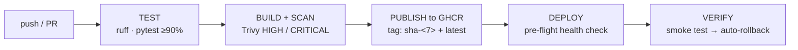

<div align="center">

# 🚀 Automated Software Delivery Pipeline

**Test it. Scan it. Ship it. Roll it back if it breaks — automatically.**


*GitHub Actions · Docker · Python (Flask) · Trivy · GHCR*

</div>

---

## 🎯 What this does

A complete delivery pipeline for a small Python web app: **test → build → security-scan → publish → deploy**, with **pre-flight checks and automatic rollback** if a release goes bad.

> **The rule:** a vulnerable image never reaches the registry, and a bad release never stays live.

## 🖼️ Architecture




📸 **Screenshots:** the architecture diagram above is the visual reference for this repo. A real GitHub Actions run screenshot can be added later from a live run — save it as `docs/screenshots/actions-run.png` and it will show here. No fake screenshots are included.

PRs run test + build + scan only (nothing published or deployed).

## ⚡ Try it locally (no GitHub, no server)

```bash
pip install -r requirements-dev.txt && ruff check . && pytest
./scripts/demo-local.sh     # needs Docker + curl
```

The demo walks through:

1. ✅ First deploy
2. ✅ Healthy upgrade
3. 🛑 Bad release rejected in pre-flight (live untouched)
4. 🔄 Bad release caught after swap (auto-rollback)
5. ↩️ Manual rollback

## ☁️ Set up on GitHub

1. Push this repo to GitHub (default branch `main`).
2. **Server**: any Linux host with Docker; create a deploy user in the `docker` group with an SSH key.
3. **Repo secrets**: `DEPLOY_HOST`, `DEPLOY_USER`, `DEPLOY_SSH_KEY` (private key), `DEPLOY_KNOWN_HOSTS` (output of `ssh-keyscan -t ed25519 <host>`).
4. **Repo variable**: `DEPLOY_URL` (e.g. `http://<host>:8080`). Open port 8080 on the server.
5. **Settings → Environments → production**: add required reviewers for a manual approval gate.
6. **Settings → Actions → General**: allow workflow read/write permissions (needed for GHCR push).
7. After the first push, set the GHCR package visibility/access if the server pull is denied (package → Package settings → give the repo access).

## 🔄 Demonstrating rollback in GitHub

- **Auto-rollback**: Actions → CI/CD → *Run workflow* → `simulate_failure = candidate` (rejected, live untouched) or `live` (swapped, fails, previous tag restored; job turns red).
- **Manual rollback**: Actions → *Manual rollback* → blank tag = previous release, or enter e.g. `sha-1a2b3c4`.

## 🧠 Design notes

- Images are tagged by commit SHA (immutable); `latest` is convenience only. Rollback always targets a SHA.
- The scan happens before the push, so a vulnerable image never reaches the registry. `ignore-unfixed` keeps the gate actionable (only CVEs with a fix available block the build).
- Container runs as non-root, multi-stage build, with a Docker `HEALTHCHECK`.
- `SIMULATE_UNHEALTHY` / `SIMULATE_FAILURE_STAGE` exist purely to demo rollback; remove them for real services.
- Third-party actions are pinned to major versions / a release; pin to commit SHAs for stricter supply-chain control.
- Scaling up: replace the SSH step with `kubectl set image` / `helm upgrade --atomic` / ECS; the pipeline shape stays the same.

## 📂 Project layout

```
.
├── .github/workflows/          # CI/CD + manual rollback
├── app/                        # Flask app
├── tests/                      # pytest (≥90% coverage)
├── scripts/                    # deploy.sh, rollback.sh, demo-local.sh
├── Dockerfile                  # multi-stage, non-root, HEALTHCHECK
├── requirements.txt
└── requirements-dev.txt
```
